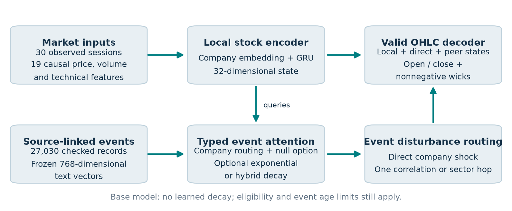
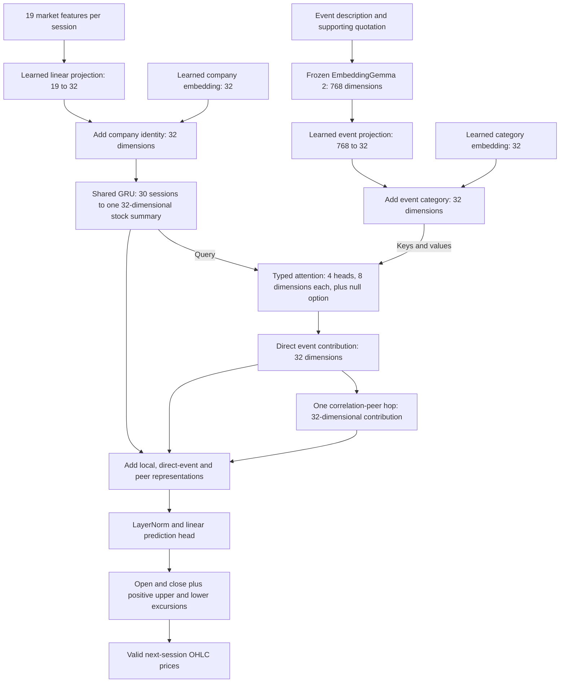
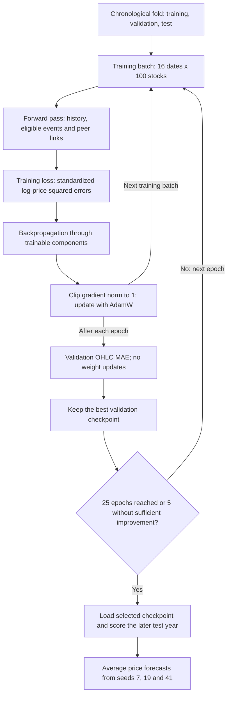

# FinSTAK

Source-linked financial events, temporal stock representations, and graph-based
next-session OHLC forecasting. This repository contains the implemented model,
tests, experiment summaries, and architecture/results reports for the expanded
**100-stock, 2014–2023 study**.

**Finding:** events add a small exploratory reduction in price error. The added
architecture family does not improve the validation-selected original family,
and direction prediction does not establish an advantage over the training-majority
rule. More stocks, events or components did not automatically improve forecasting.

## Architecture at a glance



The reference model combines each stock's recent market history with eligible
event evidence and one hop of related-company event contributions. "No learned
decay" retains the event branch, the null-attention option, and event age limits.
[Open the vector diagram](reports/expanded-study/figures/architecture.svg).

## Start here

- [Expanded-study report (PDF)](reports/expanded-study/FinSTAK_Expanded_Dataset_Report.pdf)
- [Expanded-study report (HTML)](reports/expanded-study/FinSTAK_Expanded_Dataset_Report.html)
- [Beginner's neural-network guide](reports/expanded-study/FinSTAK_Neural_Network_Explained.html)
- [All 17 configurations (CSV)](reports/expanded-study/FinSTAK_Results.csv)
- [Recomputed report facts and uncertainty](results/report-verification/report_facts.json)
- [Original detailed project documentation](docs/legacy/STAK_GRAPH_README.md)

Download HTML files to open them locally; GitHub displays their source rather
than executing them. Historical paths in archived reports identify the original
research environment; they are not paths expected on your machine.

## Expanded-study results

All rows use the same **74,900 held-out stock-date targets** from three annual
test folds (2021–2023), with three-seed ensembles. Lower normalized OHLC MAE is
better; this is mean absolute price error divided by observed decision-day close.

| Configuration | Normalized OHLC MAE |
| --- | ---: |
| Price-only GRU | 0.965918% |
| FinSTAK, no learned decay | 0.964184% |
| Hybrid decay | 0.964000% |
| Combined new recipe | 0.973310% |

No-decay FinSTAK reaches **51.07% close-direction accuracy**, versus **51.44%** for
the training-majority direction rule. **66.79%** of individual OHLC fields are
within a 1% tolerance of the observed decision-day close. Tolerance hits are not
directional accuracy. Hybrid decay's paired price-error interval against no decay
includes zero. The small no-decay-versus-price-only price gain has a positive
exploratory date-block interval, without a multiple-comparison correction.

Validation-selected original-family error is 0.964184%; validation-selected
added-component-family error is 0.964994%. The final fold's validation choice is
no-decay FinSTAK, rather than the test-set best-ranked recipe.

Post-hoc one-session return ranking is weak: no-decay FinSTAK has mean daily
cross-sectional return IC 0.00739 and RankIC 0.00368 on 100 stocks over 749 dates.
See the [diagnostic definition and annual results](results/report-verification/finstak_return_ic_comparison.json).
These are not matched to KiT's 20-session daily-horizon tests.

## Data and verification boundaries

- 100 manually selected US stocks in 11 static research sector groups.
- 2014–2023 market observations, final source session 2023-12-28, plus warm-up.
- 251,500 study-period stock-session rows plus 6,400 warm-up rows.
- **27,030 event records:** 24,187 quoted FNSPID assertions and 2,843 SEC records.
- Seven categories, including 2,770 dividend declarations added after the original
  six-category collection fell below the event-count target.
- Pinned FNSPID sources, with complete supplementary Yahoo series for 21 companies.
- Source, entity, quotation, category and duplicate checks are automated.
  **No event records have human semantic certification.**
- Records are not guaranteed to be unique underlying economic events. All exported
  confidence fields are null; this run does not validate calibrated confidence-weighted edges.
- News availability assumes a two-calendar-day delay; true historical arrival is
  not established. Static groups, retrospective adjustments, universe selection
  and unknown text-model pretraining overlap limit historical realism.

The fresh November 13 run repeats the existing historical experiment; it is not a
new untouched test. The November 22 checks verified all 153 checkpoint hashes,
51 seed-7 model/year replays and future-input/target perturbations. All 153 model
state dictionaries match the retained original run; serialized files differ and
forecast differences are at floating-point rounding scale.

## Architecture

1. Nineteen causal price/volume/technical features per session; shared trailing
   OHLC normalization and separate log-volume normalization.
2. A shared 32-unit GRU summarizes each stock's 30-session window, with learned
   company identity embeddings.
3. Frozen 768-dimensional EmbeddingGemma 2 event vectors are projected to 32
   dimensions and combined with learned event-category embeddings.
4. Four-head typed attention with a learned null option injects eligible event
   contributions into explicitly named companies.
5. One correlation-peer hop transports event contributions, using up to three
   peers from trailing 60-return correlations >= 0.2; sector routing is an ablation.
6. The prediction head constructs valid next-session OHLC from body and positive
   wick components in log-price coordinates.

### Embeddings and dimensions



The **768-dimensional text encoder stays frozen**. Its 32-dimensional projection,
the company/category embeddings, GRU, attention and active prediction layers learn
from the forecasting loss. Embedding size does not determine a branch's influence.
Peer links come from trailing stock-return correlations, not text-embedding similarity.
The diagram shows the reference model; the FinBERT, sector and combined conditions
are separate experiments.

### Training and checkpoint selection



Training uses learning rate **0.001** and weight decay **0.001**. The default loss
equally averages open/close and high/low task losses; it differs from the normalized
absolute error used to select checkpoints and report price results. Each fold
refits training-only scalers and excludes examples whose labels cross a split boundary.
Validation selects checkpoints; test scores do not select them. The three fold
train/validation end-year pairs are **2019/2020**, **2020/2021**, and **2021/2022**,
followed by tests in **2021**, **2022**, and **2023**, respectively.

The scale-study event extraction is rule-based. The earlier project also contains
LLM-extraction components, but these should not be confused with this collection's
extraction procedure. This is not a full HGT reproduction. Historical supply-chain,
analyst-consensus and live-arrival feeds are not implemented.

## Install and run the CPU tests

Python 3.13 was used for the reproduced study. The package retains its original
name `stak-graph`; import it as `stak_graph`.

```bash
python -m venv .venv
source .venv/bin/activate
python -m pip install -e '.[experiment]'
python -m unittest discover -s tests -v
```

Publication preparation ran **183 tests: 180 passed and 3 optional checks were
skipped**, with no failures. See [publication validation](provenance/publication_validation.json).
Pretrained text-model weights and their optional tokenizer tests are not included.

## Obtain the research artifacts

The private `expanded-study-v1` release contains
`FinSTAK_100stocks_2014-2023_research.tar.gz` and its checksum manifest. This is
the **retained original expanded study**, including frozen source, packed research
inputs, 153 checkpoints, forecasts and audit evidence. It is about 716 MiB.

Large raw news exports and pretrained foundation/text-model weights are excluded.
The retained vectors support historical replay without downloading those encoders.
Source-provider and model terms continue to apply to the underlying materials.

With GitHub CLI authenticated to an account that can access this private repository:

```bash
gh release download expanded-study-v1 --repo MeghanaShanthappa/FinSTAK --dir artifacts
python scripts/verify_download.py artifacts/FinSTAK_100stocks_2014-2023_research.tar.gz
mkdir -p extracted-study
tar -xzf artifacts/FinSTAK_100stocks_2014-2023_research.tar.gz -C extracted-study
```

Replay 100 historical ensemble forecasts on CPU:

```bash
python scripts/replay_scale_forecast.py \
  --study extracted-study/finstak-100x10-v1 \
  --stage data_stage --fold 2023 --variant no_decay \
  --date 2023-12-27 --device cpu --output forecast.json
```

Run a fresh reproduction on a CUDA GPU, preserving the original artifacts:

```bash
python scripts/reproduce_expanded.py \
  --study extracted-study/finstak-100x10-v1 \
  --output runs/expanded-reproduction --device cuda
```

Use `--check-only` to verify the frozen implementation and packed-input hashes
without fitting. The launcher uses the archived frozen implementation and its
recorded 25-epoch, patience-5, 16-date-batch protocol. Three seeds and three annual
folds give 153 fits. A100 reproduction took about 3 hours 27 minutes; runtime varies.
The original run used PyTorch 2.11.0+cu130 and NumPy 2.4.6. See [runtime metadata](provenance/runtime_versions.json).

## Repository map

| Path | Contents |
| --- | --- |
| `stak_graph/` | Extraction, embedding, graph, model and experiment code |
| `configs/` | Pinned pilot and expanded-study configurations |
| `examples/` | Small development fixtures, explicitly not research evidence |
| `tests/` | Unit and integration checks |
| `scripts/reproduce_expanded.py` | Portable launcher using released frozen inputs/code |
| `scripts/` | Acquisition, replay and original research procedures |
| `reports/expanded-study/` | PDF, HTML, beginner guide, figures and metric CSV |
| `results/original-expanded-study/` | Retained original-run summaries |
| `results/reproduction-2026-11-13/` | Fresh annual metrics, histories and selection locks |
| `results/report-verification/` | Recomputed metrics, uncertainty and replay checks |
| `analysis/` | Historical report-analysis procedures with recorded machine paths |
| `provenance/` | Source/model revisions, checksums and publication validation |

Older acquisition and reporting procedures preserve original absolute paths.
Use the portable commands above for replay/reproduction. JSON histories in the
fresh-run folder describe its own checkpoint files; their serialized hashes must
not be substituted for the different original-run files in the release archive.

This repository documents research outcomes, not a validated trading strategy.
